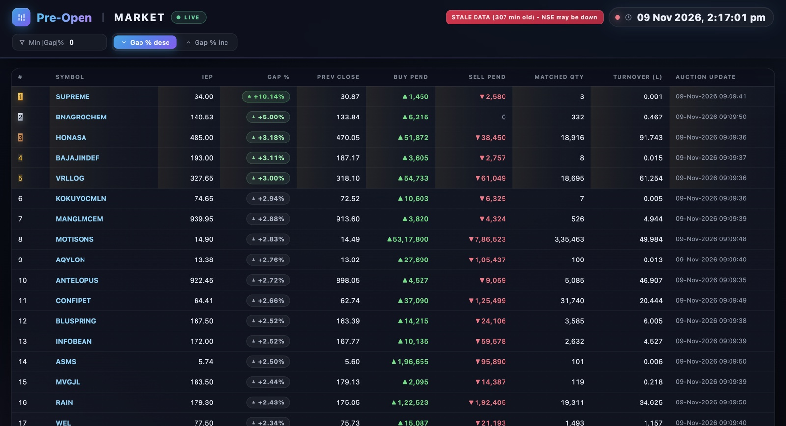

<div align="center">

# 🎯 Pre-Open Gap-Up Scanner

**A real-time ranked view of the NSE pre-open auction session (09:00–09:15 IST) — broker-free, self-hostable, and built entirely on a 100% free infrastructure stack.**

[](https://github.com/v4ibhavvv-droid/preopen-scanner/actions/workflows/docker-publish.yml)
[](https://preopen-scanner-latest.onrender.com)
[](https://www.python.org/)
[](https://github.com/v4ibhavvv-droid/preopen-scanner/pkgs/container/preopen-scanner)



*Ranked gap-up board with auction order-book depth, momentum deltas and one-click Zerodha Kite chart links. (Captured post-market on a weekend — hence the staleness banner; on a live session the clock and rows tick every poll.)*

</div>

---

## 📌 Overview

`preopen-scanner` polls the **official NSE pre-open API** continuously during the
9:00–9:15 IST pre-open auction, computes each stock's **Indicative Gap %**
(IEP vs previous close), ranks the full universe of ~2,200 symbols and renders
the result as a **zero-dependency live dashboard** in the browser.

> **Use case:** getting an early, quantified view of the day's largest gap-ups —
> e.g. short-side candidates after failed opening-drive — *before* the market
> starts continuous trading. No broker account, no API key, no paid plan.

### Key highlights

| | |
|---|---|
| 🌐 **Live hosted instance** | [preopen-scanner-latest.onrender.com](https://preopen-scanner-latest.onrender.com) — runs 24×7 on Render's free tier, kept warm by a zero-cost keep-alive pinger |
| 🖥️ **Everything in one page** | Single-file HTML/CSS/JS dashboard served by Python's stdlib `http.server` — no Node build, no client framework |
| 🛡️ **Resilient by design** | Never-die poller thread + watchdog auto-restart + exponential backoff + staleness warnings |
| 🥇 **Professional UX** | Ranked table with medals, colour-coded gap chips, Δ-IEP momentum arrows, live IST clock, instant symbol search & filters |
| 💰 **Cost** | ₹0 — free CI/CD (GitHub Actions), free GHCR image registry, free hosting |

## 🏗️ Architecture

```
 ┌────────────────── NSE India (official) ──────────────────┐
 │   GET /api/market-data-pre-open?key=ALL                  │
 │   ~2,200+ symbols per request, incl. auction order book  │
 └────────────────────────┬────────────────────────────────-┘
                          │  curl_cffi — Chrome TLS
                          │  impersonation + cookie warm-up
                          │  (Akamai-botnet-safe)
              ┌───────────▼───────────┐
              │   Poller thread       │  every POLL_INTERVAL_SEC
              │   (never dies)        │  exponential backoff on errors
              └───────────┬───────────┘
                          │  raw auction JSON
              ┌───────────▼───────────┐
              │   Engine              │  parse → MIS filter → gap% calc
              │                       │  Δ-IEP momentum vs. last poll
              └───────────┬───────────┘
                          │  ranked rows
              ┌───────────▼───────────┐
              │   Board (state store)  │  latest snapshot, always swap-in
              └───────────┬───────────┘
                          │
    ┌─────────────────────▼───────────────────────────┐
    │  ThreadingHTTPServer (stdlib, no frameworks)    │
    │   GET /          → live HTML dashboard          │
    │   GET /api/board → JSON feed (rows + metadata)  │
    │   GET /health    → liveness JSON (poller state) │
    └────────────────────────────────────────────────-┘
```

## 📊 Data source

- **Endpoint:** `https://www.nseindia.com/api/market-data-pre-open?key=ALL` — the official, public pre-open feed; one request returns the entire session (price + matched quantity + pending buy/sell orders + turnover for ~2,200 symbols).
- **Access strategy:** requests are sent through [`curl_cffi`](https://github.com/lexiforest/curl_cffi) with a Chrome TLS fingerprint and a periodic cookie warm-up, which keeps the exchange's bot-detection (Akamai) happy from datacenter IPs as well — validated 100% pass-rate from a cloud runner.
- **Politeness:** the poll cadence is deliberately gentle (6 s locally, 10 s for the hosted instance) and backs off exponentially on failures. Use of the exchange's data is acknowledged as a courtesy sampling, not scraping-at-scale.

## 🧮 Columns reference

| Column | Meaning |
|---|---|
| Prev Close | Previous close price of the stock |
| **IEP** | Indicative Equilibrium Price — the auction's current indicative opening price |
| **Gap %** | `IEP vs prev close` as a percentage — **the primary ranking metric** |
| Δ IEP | Change in IEP since the last poll (auction momentum: ▲ rising, ▼ falling) |
| Matched Qty | Quantity matched at the IEP so far (`finalQuantity`) — proxy for genuine interest |
| Buy Pend / Sell Pend | Pending buy/sell quantities in the auction order book (rebalance-risk hint) |
| Turnover (L) | Traded turnover in the pre-open, in ₹ lakh |
| Auction Update | NSE-side auction timestamp for that individual stock |

## ✨ Feature tour

- **Ranked live table** — sorted by gap % (descending), re-rendered after every poll
- **One-click charts** — click any symbol to open its **Zerodha Kite** chart in a new tab
- **Instant filters** — minimum |gap|% input, minimum matched quantity, symbol search, three sort modes
- **Mortality-proof pipeline** — watchdog restarts the poller if it stalls (>120 s without a success), with epoch-based graceful takeover so two pollers never double-hit the exchange
- **Operational visibility** — `GET /health` JSON (poller alive, poll counts, error stats) suitable for uptime monitors
- **Staleness warnings** — the dashboard flags data older than 2 minutes instead of silently showing a stale board
- **Refined dark UI** — aurora background loops, animated splash intro, sticky header, colour-coded movers

## 🚀 Quick start (local)

```bash
git clone https://github.com/v4ibhavvv-droid/preopen-scanner.git
cd preopen-scanner

python3 -m venv .venv
source .venv/bin/activate        # Mac / Linux
pip install -r requirements.txt

python run.py                    # LIVE — serves http://127.0.0.1:8787
```

CLI modes:

```bash
python run.py --dev              # offline rehearsal from a bundled fixture (no network)
python run.py --once             # single fetch, print top-20 JSON, exit
python run.py                    # live dashboard + poller + watchdog
```

**Mac one-click launchers:** double-click `START_SCANNER.command` (kills an old
instance safely, starts fresh, opens the browser only once `/health` responds)
or `STOP_SCANNER.command`. Both target *only* the listening process — browser
tabs are never touched.

## ⚙️ Configuration

All behaviour is overridden through environment variables — with safe local defaults:

| Variable | Default (local) | Purpose |
|---|---|---|
| `HOST` | `127.0.0.1` | Bind address — containers set `0.0.0.0` |
| `PORT` | `8787` | HTTP port for the dashboard |
| `POLL_INTERVAL_SEC` | `6.0` | NSE poll cadence (seconds) |
| `COOKIE_WARM_MAX_AGE` | `900` | Seconds between cookie warm-up cycles |

## ☁️ Deployment (Render — free, no credit card)

The image is published to GHCR by CI, so hosts can **pull without building**:

1. Create a Render account via **GitHub sign-in** (free — no card required).
2. `New +` → **Web Service** → **Existing Image** tab.
3. Image URL: `ghcr.io/v4ibhavvv-droid/preopen-scanner:latest`
4. Settings: **Region** `Singapore` · **Instance** `Free` · **Health check path** `/health` · Env vars `PORT=8787`, `POLL_INTERVAL_SEC=10`.
5. Deploy — the service is live in minutes.

Spin-down prevention: the repo ships
[`keepalive.yml`](.github/workflows/keepalive.yml) — a GitHub Actions cron
that pings `/health` every 5 minutes, keeping the free-tier instance permanently
warm at zero cost. Render's outbound-heavy suspend clause is respected: the outbound
footprint is just one gentle NSE poll every 10 s. (A failed keep-alive run
emails the repo owner automatically, doubling as downtime alerting.)

### CI/CD

| Workflow | Purpose |
|---|---|
| [`docker-publish.yml`](.github/workflows/docker-publish.yml) | Builds & pushes two images to GHCR: `preopen-probe` (API-access probe) and `preopen-scanner` (full app) |
| [`cloud-nse-probe.yml`](.github/workflows/cloud-nse-probe.yml) | Rerunnable validation: exposes the NSE pre-open API from a GitHub-Actions datacenter IP for ~24 min and reports pass-rate |
| [`keepalive.yml`](.github/workflows/keepalive.yml) | 5-minute health pings — keeps the hosted instance warm; failures also double as downtime alerting (GitHub emails the owner) |

## 🩺 Health endpoint

```json
GET /health
{
  "status": "ok",
  "poller_alive": true,
  "last_poll_age_sec": 4.5,
  "total_polls": 23,
  "consecutive_errors": 0,
  "total_errors": 0,
  "last_error": ""
}
```

## 🔭 Roadmap

1. **Phase 1 ✅ — Pre-open scanner + live dashboard (broker-free, NSE-only)** *← current*
2. **Phase 2 —** trend telemetry across sessions (gap desk with history instead of single-day)
3. **Phase 3 —** alerting hooks (alert when a top-N gap-up forms mid-auction)

## 📁 Project structure

```
preopen-scanner/
├── run.py                         entry point (poller + watchdog + HTTP server)
├── config.py                      tunables (ports, cadence, warm-up age)
├── scanner/
│   ├── nse_client.py              curl_cffi fetch + cookie warm-up
│   ├── engine.py                  parse, gap% computation, ranking
│   ├── mis_filter.py              MIS-allowed universe (cached daily)
│   ├── kite_links.py              Zerodha Kite deep links
│   └── dashboard.py               single-file UI + HTTP routes
├── deploy/
│   ├── Dockerfile                 probe image
│   ├── Dockerfile.app             full-app image (used on Render)
│   └── probe.py                   standalone API-access prober
├── data/mis_allowed.json          MIS-permitted symbols snapshot (refreshed daily)
├── fixtures/                      offline fixture for --dev mode
├── START_SCANNER.command          double-click launcher (auto-restart safe)
├── STOP_SCANNER.command           clean stopper (listener-only kill)
└── .github/workflows/             image CI + API probe + keep-alive
```

---

## ⚠️ Disclaimer

This is a **personal research tool**, not investment advice or an offer of any
kind. Market data is sampled gently and with respect for the exchange's
infrastructure; no affiliation with NSE India or Zerodha is implied.
Trading involves risk of loss — do your own diligence.

**Built with** Python 3.14, `curl_cffi`, stdlib-only HTTP serving, GitHub
Actions, GHCR and Render's free tier — a deliberately boring, paid-service-free
stack that anyone can run again tomorrow.
